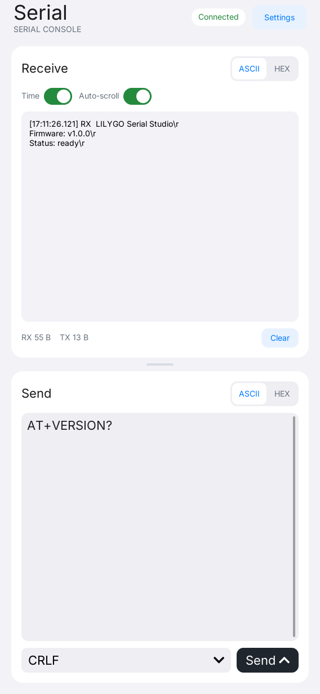
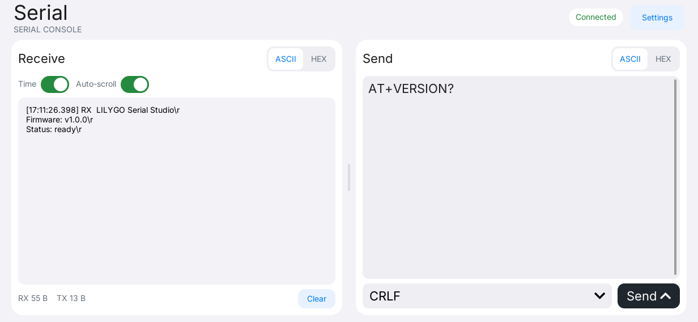

# LILYGO Serial

**English** | [简体中文](README.zh-CN.md)

LILYGO Serial is a serial port debugging tool for LILYGO UI, built with C++17,
[LILYGO UI AppKit](https://github.com/LILYGO-UI/cm0-appkit) and LVGL 9.5.
Discover USB and UART devices, configure a connection, inspect received bytes
in ASCII or HEX, and send data or control modem lines from a touch interface.

The project provides a CM0 ARM64 Linux build and an SDL2 desktop simulator
for Linux and macOS development and testing. Serial communication works locally
and does not require internet access.

## Preview

<p>
  
  
</p>

The landscape preview uses data from an automated pseudoterminal session.

## Features

- **Port discovery:** scan common USB and UART device nodes on Linux and
  `/dev/cu.*` on macOS, then select a port from the list.
- **Connection settings:** open **Settings** to select the baud rate, 5–8 data
  bits, none/odd/even parity, 1 or 2 stop bits, and none/RTS-CTS/XON-XOFF flow control.
- **Receive console:** switch between ASCII and HEX, toggle timestamps and
  automatic scrolling, clear history, and monitor RX/TX byte counters.
- **Sending:** independent ASCII/HEX input with optional LF, CR, or CRLF endings;
  nonblocking output queues handle partial writes.
- **Line control:** toggle RTS, DTR, and BREAK from **Settings** when the driver supports them.
- **Responsive interface:** spacious receive and send panels, stacked in portrait
  and side by side in landscape, with an on-screen keyboard and shared AppKit fonts.

The simulator accesses real host serial devices. Device permissions and adapter
capabilities still apply; RTS is managed by the driver when RTS/CTS flow control
is enabled. See the [serial usage guide](docs/02-serial-usage.md) for port filters,
data formats, buffer limits, and hardware limitations.

## Quick Start

1. Connect the adapter, open **Settings** at the top, select **Scan**, and choose
   its device node in **Connection**.
2. Match the device's serial settings and select **Connect**. Defaults are
   **115200 / 8N1 / no flow control**. Disconnect before changing ports or settings.
3. Select **Back** to return to the receive and send console. ASCII, timestamps,
   and automatic scrolling are enabled by default. RX display and TX input formats
   are independent.
4. Enter ASCII text such as `Hello`, or switch TX to HEX and enter
   `48 65 6C 6C 6F`. Choose a line ending if needed, then select **Send**.
5. Open **Settings** for **Line control** as needed, or to disconnect when finished.

Opening or leaving **Settings** keeps the connection, ongoing serial I/O, receive
history, and unsent input intact. The main console gives its space to Receive and
Send, split equally by default. Drag the divider to resize the panels. Both remain
visible while typing; **Hide keyboard** restores the space using your chosen ratio.

The receive console shows RX data only; sending updates the TX counter without
echoing the payload into the console. ASCII input accepts 7-bit characters;
HEX requires complete byte pairs and rejects `0x` prefixes or commas.
History is bounded and kept in memory. **Clear** resets history and counters
but keeps queued output; disconnecting discards output that has not yet been written.

## Development Environment

Project identity, version, and package metadata come from [`lpm.toml`](lpm.toml).
[`CMakePresets.json`](CMakePresets.json) defines the `host-simulator` and
`cm0-cross` configurations. Run all project commands from the repository root.

### Prepare the Source

In your checkout, initialize the pinned dependencies:

```sh
git submodule update --init --recursive
```

AppKit is consumed directly from `third_party/cm0-appkit`; a separate AppKit
installation is not required for the simulator. Its bundled LVGL 9.5.0 archive
is used by default, with network fetching disabled in both presets.

This checkout has no configured public source repository. The HTTPS `.invalid`
URLs in `lpm.toml` are placeholders; replace them with the real source repository
and homepage before publishing.

### Host Dependencies

Use CMake 3.21 or later (including CTest and CPack), Python 3.11 or later for LPM,
and a C/C++ compiler with C++17 support. The presets use Unix Makefiles.
SDL2 supplies the host display and FreeType supplies font rendering.
Device builds also use `patch` to apply AppKit's bundled LVGL patches.
The serial backend uses POSIX APIs provided by Linux and macOS.

#### Debian 12 / Ubuntu 24.04 or Later

```sh
sudo apt update
sudo apt install build-essential cmake git pkg-config patch libsdl2-dev \
  libfreetype6-dev ca-certificates python3 python3-venv python3-pip
```

On older distributions, upgrade CMake and Python to the minimum versions above.

#### macOS

Install the Xcode Command Line Tools if needed and dependencies through
[Homebrew](https://brew.sh/). Complete the Homebrew shell setup so that `brew`
and its installed tools are on `PATH`:

```sh
xcode-select --install
brew install git cmake pkg-config patch sdl2 freetype python
```

#### LPM

CMake invokes `lpm metadata --format cmake` during configuration. Install LPM
in a project-local environment using Python 3.11 or later:

```sh
python3 -m venv .venv
. .venv/bin/activate
python -m pip install "git+https://github.com/LILYGO-UI/lpm.git"
lpm --version
```

Reactivate the environment with `. .venv/bin/activate` in each new terminal
before running `lpm`. CMake searches `.venv/bin` as well as `PATH`. An existing
LPM installation can also be selected with
`-DLPM_EXECUTABLE=/absolute/path/to/lpm` during configuration.

Check the host environment before building:

```sh
cmake --version
python --version
pkg-config --modversion sdl2 freetype2
lpm metadata --format cmake
```

### Device Cross Compiler

Skip this step when only building the desktop simulator. Device builds need
a separate AArch64 Linux cross compiler on the development machine.

**Debian / Ubuntu:**

```sh
sudo apt install gcc-aarch64-linux-gnu g++-aarch64-linux-gnu
```

**Apple Silicon macOS:**

```sh
brew install aarch64-unknown-linux-gnu
```

The BSP toolchain expects these executable names on `PATH`:

```sh
aarch64-linux-gnu-gcc --version
aarch64-linux-gnu-g++ --version
```

See [CM0BspBuilder](https://github.com/LILYGO-UI/CM0BspBuilder) for SDK host
and compiler requirements. The BSP supplies target headers and libraries but
does not install the host cross compiler.

## Build and Test

After completing the environment setup, use LPM from the repository root.
It reads the build presets and package output directory from `lpm.toml`.

### Desktop Simulator

```sh
lpm start --foreground
```

This configures and builds the simulator, then starts it in the foreground.
To reuse an existing build, run `lpm start --no-build --foreground`.
The Debug build has tests enabled and is stored in `build/host-simulator`.
Running the application requires a graphical desktop session. Attach a serial
device and grant your user access to it to exercise real communication.

### Tests

Configure and build the host simulator, then run all tests:

```sh
lpm test
```

| Test | Coverage |
| --- | --- |
| `serial-core` | ASCII/HEX parsing, pseudoterminal I/O, output queues, counters, history limits, and connection cleanup |
| `serial-view-model` | User commands, settings, independent RX/TX formats, log formatting, and Subject updates |
| `serial-render-portrait` | Rendering and interactions at `568 x 1232` |
| `serial-render-landscape` | Rendering and interactions at `1232 x 568` |
| `serial-render-compact` | Rendering and interactions at `390 x 844` |
| `serial-render-small-landscape` | Rendering and interactions at `844 x 390` |

Render tests write `serial-<viewport>.ppm` under `build/host-simulator`, plus
`-empty`, `-send`, `-keyboard`, `-resized`, `-settings`, `-settings-resized`,
`-settings-error`, `-keyboard-error`, and `-split` variants for each viewport (40 images in total). Inspect these
states across all four viewports after UI changes; passing assertions alone does
not verify the visual layout. Follow the
[UI development guidelines](docs/01-user-interface.md) for acceptance requirements.

Tests use pseudoterminals and an in-memory display, so no external serial device
or graphical session is needed. They do not verify electrical RTS/DTR/BREAK
behavior or every adapter's supported settings; validate those on the intended hardware.

### CM0 Device Build

The device preset targets CM0 Raspberry Pi OS on AArch64, uses a Release build,
disables host tests, and sets the installation prefix to `/usr`.
Cross-compile and create the Debian package:

```sh
lpm pack
```

The first `lpm pack` (or `cmake --preset cm0-cross`) uses the
[toolchain wrapper](cmake/cm0-bsp-toolchain.cmake) to download CM0 BSP `0.1.0`,
verifies its pinned SHA-256 checksum, and extracts the sysroot to
`.cache/cm0-bsp/0.1.0/sysroot`. The first download requires access to GitHub;
later configurations reuse this cache. To change the cache location, pass
`-DCM0_BSP_CACHE_DIR=/absolute/path/to/cache` when configuring.
No sibling CM0BspBuilder checkout is required.

Cross compilation needs target libraries and headers, including FreeType and
DRM, in the SDK sysroot. Host libraries cannot substitute for missing target
dependencies.

CPack writes an ARM64 `.deb` to `dist/`. The package installs the executable,
launcher entry and icon, desktop entry, AppStream metadata, and shared-font
license notices. The target system must provide the declared dependencies:
`libc6`, `libstdc++6`, `libdrm2`, `libfreetype6`, and
`lilygo-ui-appkit-dev >= 0.1.0`. AppKit supplies shared runtime fonts on the device.

<details>
<summary>Underlying CMake commands</summary>

LPM wraps the following steps. You can also run them directly when debugging
the build configuration; LPM is still required to read project metadata.

Host build and tests:

```sh
cmake --preset host-simulator
cmake --build --preset host-simulator --parallel
ctest --preset host-simulator
```

Device build and packaging:

```sh
cmake --preset cm0-cross
cmake --build --preset cm0-cross --parallel
cpack --config build/cm0-cross/CPackConfig.cmake -B dist
```

</details>

### Troubleshooting

| Symptom | Action |
| --- | --- |
| `lpm is required to read project metadata` | Install LPM in `.venv`, put it on `PATH`, or set `LPM_EXECUTABLE`. |
| `LilyGoUI` or bundled LVGL cannot be found | Initialize the pinned AppKit submodule with `git submodule update --init --recursive`. |
| SDL2 or FreeType is missing | Install the host development packages; for cross builds, check the target sysroot. |
| Homebrew libraries are not found | Configure with `cmake --preset host-simulator -DCMAKE_PREFIX_PATH="$(brew --prefix)"`. |
| BSP download fails | Check access to GitHub releases and available disk space, then rerun configuration. |
| No port appears or opening it fails | Select **Scan**, check the device path, driver, permissions, and other serial programs; see the [usage guide](docs/02-serial-usage.md). |
| Received bytes are unexpected or a line control fails | Match the device's connection settings and flow control; verify adapter support. Use HEX to inspect raw bytes. |

## Documentation

| Guide | Contents |
| --- | --- |
| [Serial usage](docs/02-serial-usage.md) | Port discovery, permissions, formats, line controls, buffer limits, and troubleshooting |
| [Architecture overview](docs/00-overview.md) (Chinese) | Module boundaries, polling, data flow, resource ownership, and project metadata |
| [UI development guidelines](docs/01-user-interface.md) (Chinese) | Layout, typography, lifecycle rules, and UI validation requirements |

## Acknowledgments

The interface uses [LILYGO UI AppKit](https://github.com/LILYGO-UI/cm0-appkit)
and [LVGL](https://lvgl.io/), with SDL2 for the host simulator and FreeType for
font rendering. AppKit's shared fonts retain their upstream license notices;
the package includes those notices through the AppKit installation helpers.
