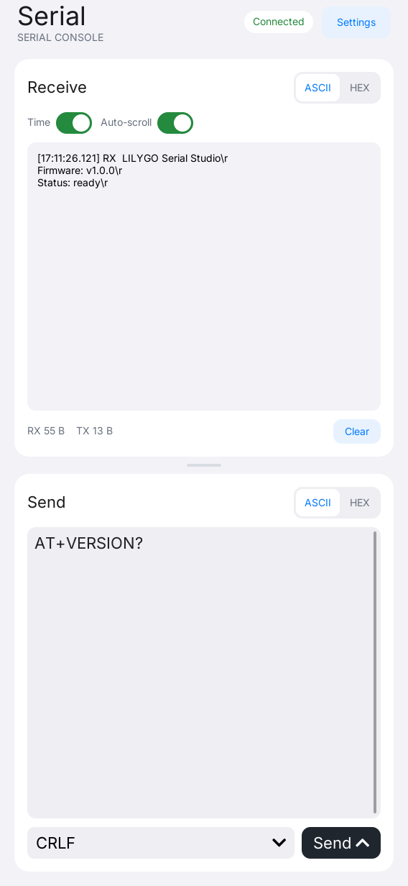
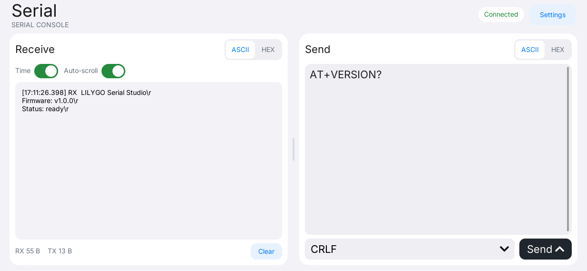

# LILYGO Serial

[English](README.md) | **简体中文**

LILYGO Serial 是面向 LILYGO UI 的串口调试工具，基于 C++17、
[LILYGO UI AppKit](https://github.com/LILYGO-UI/cm0-appkit) 和 LVGL 9.5 构建。
通过触屏界面扫描 USB 和 UART 设备、配置连接、以 ASCII 或 HEX 查看接收字节，
并发送数据或控制串口线路。

项目提供 CM0 ARM64 Linux 设备构建，以及用于 Linux 和 macOS 开发与测试的
SDL2 桌面模拟器。串口通信在本机进行，运行时无需联网。

## 预览

<p>
  
  
</p>

横屏预览中的数据来自自动化伪终端收发测试。

## 功能

- **端口发现：** 扫描 Linux 常见 USB、UART 设备节点及 macOS 的 `/dev/cu.*`，
  然后从列表中选择端口。
- **连接参数：** 进入 **Settings**（设置）配置波特率、5–8 位数据位、无/奇/偶校验、1 或 2 位停止位，
  以及无流控、RTS/CTS 硬件流控或 XON/XOFF 软件流控。
- **接收控制台：** 切换 ASCII 与 HEX 显示、时间戳和自动滚屏，清空历史，查看 RX/TX 字节计数。
- **数据发送：** 独立选择 ASCII/HEX 输入，可追加 LF、CR 或 CRLF；非阻塞发送队列处理短写。
- **线路控制：** 在 **Settings** 中切换驱动支持的 RTS、DTR 和 BREAK。
- **响应式界面：** 为接收和发送区提供更大空间，竖屏上下排列、横屏左右排列，
  支持紧凑视口，提供屏幕键盘并使用 AppKit 共享字体。

模拟器访问开发机上的真实串口，仍受设备权限和适配器能力限制。
启用 RTS/CTS 流控时，RTS 由驱动管理。端口过滤规则、数据格式、缓冲区限制和硬件能力说明
见[串口使用指南](docs/02-serial-usage.md)（英文）。

## 快速开始

1. 接入适配器，点击顶部 **Settings**（设置），在 **Connection**（连接）中
   点击 **Scan**（扫描），选择设备节点。
2. 设置与设备一致的串口参数，点击 **Connect**（连接）。默认值为
   **115200 / 8N1 / 无流控**，修改端口或参数前需先断开连接。
3. 点击 **Back**（返回）回到收发控制台。默认开启 ASCII 显示、时间戳和自动滚屏，
   接收与发送格式独立设置。
4. 输入 `Hello` 等 ASCII 文本，或将发送格式切换为 HEX 后输入
   `48 65 6C 6C 6F`。按需选择结束符，然后点击 **Send**（发送）。
5. 按需进入 **Settings** 使用 **Line control**（线路控制），使用结束后在设置中断开连接。

进入或退出设置会保留连接、进行中的串口收发、接收历史和未发送的输入。
主界面的 Receive（接收）和 Send（发送）默认对半分配空间，可拖动中间分隔条调整比例。
打开键盘时仍能查看两个面板；点击顶部 **Hide keyboard** 收起键盘后恢复调整过的比例。

接收区只显示 RX 数据；发送会更新 TX 计数，不会将发送内容回显到接收区。
ASCII 输入接受 7 位字符；HEX 必须使用完整字节对，不接受 `0x` 前缀或逗号。
历史记录有容量上限且仅保存在内存中。**Clear**（清空）会清除历史和计数，但保留待发队列；
断开连接会丢弃尚未写出的数据。

## 开发环境搭建

项目标识、版本和软件包元数据由 [`lpm.toml`](lpm.toml) 提供。
[`CMakePresets.json`](CMakePresets.json) 定义了 `host-simulator` 和 `cm0-cross` 配置。
所有项目命令均在仓库根目录执行。

### 准备源码

在已有源码仓库中初始化锁定版本的依赖：

```sh
git submodule update --init --recursive
```

项目直接使用 `third_party/cm0-appkit`，模拟器无需单独安装 AppKit。
默认使用其中附带的 LVGL 9.5.0 源码归档，两种预设均禁用了 LVGL 网络下载。

当前仓库尚未配置公开源码地址。`lpm.toml` 中的 HTTPS `.invalid` 地址是占位值，
正式发布前须替换为真实的源码仓库和主页。

### 主机依赖

需要 CMake 3.21 或更高版本（包含 CTest 和 CPack）、供 LPM 使用的 Python 3.11 或更高版本，
以及支持 C++17 的 C/C++ 编译器。预设使用 Unix Makefiles。
SDL2 提供主机显示，FreeType 负责字体渲染；设备构建还需要 `patch` 来应用 AppKit 附带的 LVGL 补丁。
串口后端使用 Linux 和 macOS 提供的 POSIX API。

#### Debian 12 / Ubuntu 24.04 或更高版本

```sh
sudo apt update
sudo apt install build-essential cmake git pkg-config patch libsdl2-dev \
  libfreetype6-dev ca-certificates python3 python3-venv python3-pip
```

较旧发行版需要先将 CMake 和 Python 升级到上述最低版本。

#### macOS

按需安装 Xcode Command Line Tools，并通过 [Homebrew](https://brew.sh/) 安装依赖。
完成 Homebrew 的 Shell 配置，确保 `brew` 及其安装的工具位于 `PATH` 中：

```sh
xcode-select --install
brew install git cmake pkg-config patch sdl2 freetype python
```

#### LPM

CMake 在配置阶段调用 `lpm metadata --format cmake`。
使用 Python 3.11 或更高版本，在项目虚拟环境中安装 LPM：

```sh
python3 -m venv .venv
. .venv/bin/activate
python -m pip install "git+https://github.com/LILYGO-UI/lpm.git"
lpm --version
```

每次打开新终端后，先执行 `. .venv/bin/activate` 再使用 `lpm`。
CMake 会同时搜索 `.venv/bin` 和 `PATH`。
如需指定其他位置的 LPM，可在配置时传入 `-DLPM_EXECUTABLE=/absolute/path/to/lpm`。

构建前检查主机环境：

```sh
cmake --version
python --version
pkg-config --modversion sdl2 freetype2
lpm metadata --format cmake
```

### 设备交叉编译器

仅构建桌面模拟器时可跳过此步骤。设备构建需要在开发机上单独安装 AArch64 Linux 交叉编译器。

**Debian / Ubuntu：**

```sh
sudo apt install gcc-aarch64-linux-gnu g++-aarch64-linux-gnu
```

**Apple Silicon macOS：**

```sh
brew install aarch64-unknown-linux-gnu
```

BSP 工具链要求 `PATH` 中存在以下名称的可执行文件：

```sh
aarch64-linux-gnu-gcc --version
aarch64-linux-gnu-g++ --version
```

SDK 对主机和编译器的要求详见 [CM0BspBuilder](https://github.com/LILYGO-UI/CM0BspBuilder)。
BSP 提供目标平台的头文件和库，但不会安装开发机所需的交叉编译器。

## 构建与测试

完成环境搭建后，在仓库根目录使用 LPM。
它会从 `lpm.toml` 读取构建预设和打包输出目录。

### 桌面模拟器

```sh
lpm start --foreground
```

此命令会配置、构建模拟器，然后以前台模式启动。
如需复用已有构建产物，执行 `lpm start --no-build --foreground`。
Debug 构建启用测试，产物位于 `build/host-simulator`。
运行应用需要图形桌面会话；验证真实通信时，需要连接串口设备并确保当前用户有权访问。

### 测试

配置、构建主机模拟器并运行全部测试：

```sh
lpm test
```

| 测试 | 覆盖内容 |
| --- | --- |
| `serial-core` | ASCII/HEX 解析、伪终端收发、发送队列、计数、历史容量限制和连接清理 |
| `serial-view-model` | 用户命令、连接参数、独立 RX/TX 格式、日志排版和 Subject 更新 |
| `serial-render-portrait` | `568 x 1232` 下的渲染和交互 |
| `serial-render-landscape` | `1232 x 568` 下的渲染和交互 |
| `serial-render-compact` | `390 x 844` 下的渲染和交互 |
| `serial-render-small-landscape` | `844 x 390` 下的渲染和交互 |

渲染测试将 `serial-<viewport>.ppm` 写入 `build/host-simulator`，每个视口还会生成
`-empty`、`-send`、`-keyboard`、`-resized`、`-settings`、`-settings-resized`、
`-settings-error`、`-keyboard-error` 和 `-split` 状态图，共 40 张。
修改 UI 后应检查四种视口及各个状态；断言通过并不能验证视觉布局。
UI 验收要求见 [UI 开发规范](docs/01-user-interface.md)。

测试使用伪终端和内存显示缓冲，不需要外接串口设备或图形会话，但无法验证
RTS/DTR/BREAK 的电气行为或所有适配器支持的参数组合，这些能力需在目标硬件上验证。

### CM0 设备构建

设备预设面向 AArch64 架构的 CM0 Raspberry Pi OS，使用 Release 构建，
禁用主机测试，并将安装前缀设为 `/usr`。交叉编译并生成 Debian 软件包：

```sh
lpm pack
```

首次执行 `lpm pack`（或 `cmake --preset cm0-cross`）时，
[工具链包装脚本](cmake/cm0-bsp-toolchain.cmake)会下载 CM0 BSP `0.1.0`，
校验锁定的 SHA-256，并将 sysroot 解压到 `.cache/cm0-bsp/0.1.0/sysroot`。
首次下载需要访问 GitHub，后续配置会复用缓存。
如需修改缓存位置，可在配置时传入 `-DCM0_BSP_CACHE_DIR=/absolute/path/to/cache`。
无需在相邻目录克隆 CM0BspBuilder。

交叉编译需要 SDK sysroot 中的目标平台库和头文件，包括 FreeType 和 DRM。
主机库不能替代缺失的目标平台依赖。

CPack 将 ARM64 `.deb` 输出到 `dist/`。软件包安装可执行文件、启动器条目及图标、
桌面条目、AppStream 元数据和共享字体许可声明。
目标系统需要提供声明的依赖：`libc6`、`libstdc++6`、`libdrm2`、`libfreetype6` 和
`lilygo-ui-appkit-dev >= 0.1.0`。AppKit 在设备上提供共享运行时字体。

<details>
<summary>底层 CMake 命令</summary>

LPM 封装了以下步骤。调试构建配置时也可以直接执行这些命令，但读取项目元数据仍需要 LPM。

主机构建与测试：

```sh
cmake --preset host-simulator
cmake --build --preset host-simulator --parallel
ctest --preset host-simulator
```

设备构建与打包：

```sh
cmake --preset cm0-cross
cmake --build --preset cm0-cross --parallel
cpack --config build/cm0-cross/CPackConfig.cmake -B dist
```

</details>

### 常见问题

| 现象 | 处理方法 |
| --- | --- |
| `lpm is required to read project metadata` | 在 `.venv` 中安装 LPM，将其加入 `PATH`，或设置 `LPM_EXECUTABLE`。 |
| 找不到 `LilyGoUI` 或附带的 LVGL | 执行 `git submodule update --init --recursive`，初始化锁定版本的 AppKit 子模块。 |
| 缺少 SDL2 或 FreeType | 安装主机开发依赖；交叉编译时检查目标 sysroot。 |
| 找不到 Homebrew 库 | 使用 `cmake --preset host-simulator -DCMAKE_PREFIX_PATH="$(brew --prefix)"` 配置。 |
| BSP 下载失败 | 检查 GitHub Releases 访问情况和可用磁盘空间，然后重新配置。 |
| 未发现端口或无法打开设备 | 点击 **Scan**，检查设备路径、驱动、权限和其他串口程序，详见[使用指南](docs/02-serial-usage.md)（英文）。 |
| 接收内容异常或线路控制失败 | 核对设备参数和流控设置，确认适配器支持对应功能；使用 HEX 查看原始字节。 |

## 文档

| 指南 | 内容 |
| --- | --- |
| [串口使用指南](docs/02-serial-usage.md)（英文） | 端口发现、权限、数据格式、线路控制、缓冲区限制和故障排查 |
| [架构概览](docs/00-overview.md) | 模块边界、轮询、数据流、资源所有权和项目元数据 |
| [UI 开发规范](docs/01-user-interface.md) | 布局、字体、生命周期规则和 UI 验证要求 |

## 致谢

界面使用 [LILYGO UI AppKit](https://github.com/LILYGO-UI/cm0-appkit) 和
[LVGL](https://lvgl.io/)，主机模拟器由 SDL2 提供显示，字体由 FreeType 渲染。
AppKit 共享字体保留上游许可声明，软件包通过 AppKit 安装辅助函数包含这些许可文件。
